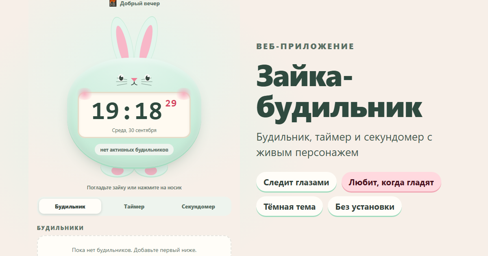

# 🐰 Зайка-будильник

Будильник, таймер и секундомер с живым персонажем. Зайка моргает, следит глазами за курсором,
шевелит носиком и лапками, а если его погладить — радуется и пускает сердечки.

**Открыть приложение:** https://vitaly-sokol911.github.io/zaika/



## Что умеет

- **Будильники** — несколько сразу, с названием и повтором по дням (будни, выходные, каждый день или свои дни).
  Разовый будильник сам выключается после звонка, есть «Отложить на 5 минут».
- **Таймер** — быстрые пресеты от 10 секунд до 30 минут или своё время; досчитывает и в фоновой вкладке.
- **Секундомер** — с кругами и разницей между ними, до сотых долей секунды.
- Всё время показывается **на табло зайки**, а когда пора — он прыгает и вздрагивает ушками под мелодию.
- **Персонализация** — четыре цвета шёрстки, светлая и тёмная тема. Настройки запоминаются.
- **Проверить звонок** — одна кнопка, чтобы сразу увидеть и услышать, как зайка будит.

## Как сделано

- **Один файл без зависимостей.** HTML, CSS и JavaScript — внутри `index.html`, никаких библиотек и шрифтов с чужих серверов.
  Открывается мгновенно и работает без интернета.
- **Звук генерируется в браузере** (Web Audio API) — никаких аудиофайлов.
- **Доступность:** контраст текста по WCAG AA, управление с клавиатуры (вкладки — стрелками, Esc закрывает окна),
  подписи для экранных дикторов, учёт настройки «уменьшить движение».
- **Адаптивность:** от телефона 320 px до десктопа.

## Безопасность

- **Строгая Content Security Policy:** браузер выполнит только встроенный CSS и JS с совпадающим SHA-256 хэшем.
  Любой внедрённый скрипт, сетевой запрос или загрузка стороннего ресурса блокируется.
- **Защита от XSS:** пользовательский текст (названия будильников) выводится только как текст, никогда как HTML.
- **Проверка данных:** всё, что читается из `localStorage`, проходит валидацию по каждому полю — испорченные
  или подменённые данные отбрасываются, а не ломают приложение.
- **Приватность:** приложение ничего не отправляет в сеть — будильники хранятся только в браузере пользователя.
- Работает по HTTPS (GitHub Pages).

## Как обновить

После правки стилей или скрипта в `index.html` или `404.html` пересчитайте хэши CSP — иначе браузер заблокирует изменённый код:

```bash
node scripts/csp-hash.mjs
```

## Ограничение

Это веб-страница: будильник звонит, пока вкладка открыта. Разбудить телефон с заблокированным экраном
браузерное приложение не может — это ограничение самих браузеров.
